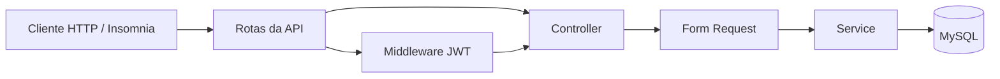

<div align="center">

# 🏦 Zago Bank

### API REST para simulação de operações financeiras

**PHP 8.2+ · Laravel 12 · MySQL 8 · JWT**

[](https://www.php.net/)
[](https://laravel.com/)
[](https://www.mysql.com/)
[](#endpoints-da-api)

**[Visão geral](#sobre-o-projeto) · [Instalação](#instalação-local) · [Endpoints](#endpoints-da-api) · [Insomnia](#testando-com-o-insomnia) · [Modelo de dados](#modelo-de-dados)**

</div>

---

## Sobre o projeto

**Zago Bank** é uma **API REST de Back-end**, desenvolvida em **PHP e Laravel**, para simular operações financeiras entre usuários. A aplicação permite cadastrar contas, autenticar usuários por JWT, realizar depósitos simulados e transferir valores entre contas.

O objetivo do projeto é demonstrar a construção de uma API com regras de negócio, persistência relacional, autenticação, autorização e preocupação com consistência de dados. A aplicação **não possui interface bancária própria**: seus endpoints podem ser consumidos por clientes HTTP como o [Insomnia](https://insomnia.rest/), Postman ou uma interface desenvolvida separadamente.

> [!IMPORTANT]
> Projeto **educacional/de portfólio**. Não processa pagamentos reais, não se conecta a instituições financeiras e **não deve ser utilizado como sistema bancário de produção**.

### Funcionalidades

- **Cadastro de usuários** com nome, email, CPF, senha e tipo de conta.
- **Login com JWT** (JSON Web Token) para acesso às rotas protegidas.
- **Dois tipos de usuário**: `COMMON` (comum) e `SELLER` (lojista).
- **Depósitos simulados** na própria conta autenticada.
- **Transferências** entre contas, com verificação de titularidade, destinatário e saldo.
- **Validações** de entradas, identificadores e valores monetários.
- **Persistência em MySQL** com Eloquent ORM e migrations.
- **Transações de banco de dados** e bloqueio de linhas para operações financeiras na versão revisada.
- **Tratamento de valores em centavos inteiros**, evitando cálculos com `float` na lógica financeira revisada.

## Tecnologias

| Tecnologia | Utilização |
| --- | --- |
| **PHP 8.2+** | Linguagem de programação |
| **Laravel 12** | Framework e estrutura da API |
| **MySQL 8** | Banco de dados relacional |
| **Eloquent ORM** | Modelagem e acesso ao banco |
| **JWT (`tymon/jwt-auth`)** | Autenticação por token |
| **Composer** | Gerenciamento de dependências |
| **Laravel Artisan** | Comandos, execução local e migrations |
| **Insomnia** | Testes manuais dos endpoints |

> A documentação descreve a **versão modernizada do projeto**, atualizada a partir da implementação original em Laravel 10. Para reproduzi-la, utilize o código correspondente à atualização para Laravel 12, incluindo os ajustes financeiros. Se estiver consultando uma branch antiga, confira o `composer.json` antes da instalação.

## Regras de negócio

### Tipos de usuário

| Tipo | Pode receber | Pode transferir |
| --- | :---: | :---: |
| `COMMON` | Sim | Sim |
| `SELLER` | Sim | Não |

**`payer`** é a conta de origem (quem envia dinheiro) e **`payee`** é a conta de destino (quem recebe). Esses termos representam o papel de cada usuário em uma transferência; não são tipos de conta.

### Regras das operações financeiras

1. Uma transferência só pode debitar a conta do **usuário autenticado**.
2. O usuário de origem não pode ser do tipo `SELLER`.
3. A conta de destino deve existir e ser diferente da conta de origem.
4. O pagador deve possuir saldo suficiente.
5. Valores enviados à API devem ser positivos e ter **no máximo duas casas decimais**.
6. Depósitos são permitidos somente na própria conta autenticada.
7. Na implementação revisada, operações de saldo usam **transações SQL e bloqueio de registros** para reduzir riscos de inconsistência em acessos concorrentes.
8. Os cálculos financeiros são feitos em **centavos inteiros** e convertidos para `DECIMAL(8,2)` na persistência. O limite suportado por saldo/valor é **999999.99**.

> **Depósito não é pagamento real:** trata-se de um crédito fictício para testar as regras da API.

## Estrutura do projeto

```text
zago-bank/
├── app/
│   ├── Exceptions/            # Exceções da aplicação
│   ├── Http/
│   │   ├── Controllers/       # Entrada das requisições
│   │   ├── Middleware/        # Validação de JWT
│   │   └── Requests/          # Autorização e validação
│   ├── Models/                # User e Transaction
│   ├── Services/              # Regras de negócio
│   └── Support/               # Utilitários monetários (versão revisada)
├── bootstrap/                 # Inicialização da aplicação
├── config/                    # Configurações, incluindo auth e database
├── database/
│   └── migrations/            # Criação das tabelas
├── public/
│   └── images/                # Diagrama do projeto
├── routes/
│   └── api/                   # Rotas organizadas por recurso
├── storage/                   # Logs e arquivos gerados
├── tests/                     # Estrutura de testes automatizados
├── .env.example               # Exemplo de configurações
├── artisan                    # CLI do Laravel
├── composer.json              # Dependências do projeto
└── README.md                  # Esta documentação
```

A aplicação mantém a separação **Controller → Form Request → Service → Model**, concentrando validações de entrada nos *Requests* e regras de negócio nos *Services*.

## Instalação local

### Pré-requisitos

- **PHP 8.2 ou superior** com as extensões necessárias ao Laravel, especialmente `pdo_mysql`, `mbstring`, `openssl` e `intl`.
- **Composer 2**.
- **MySQL 8** em execução.
- **Git**.
- **Insomnia** ou outro cliente HTTP (opcional, recomendado).

> **Docker não é obrigatório.** O passo a passo abaixo usa PHP, Composer e MySQL instalados diretamente na máquina. Configurações antigas de Laravel Sail/Docker podem precisar de revisão para funcionar com a versão modernizada.

### 1. Clonar o repositório

```bash
git clone https://github.com/richzago/zago-bank.git
cd zago-bank
```

> Verifique se a versão clonada já contém as atualizações para Laravel 12. O README da versão nova não altera automaticamente a versão do código disponível no GitHub.

### 2. Instalar as dependências

```bash
composer install
```

### 3. Criar o arquivo de ambiente

No **PowerShell** (Windows):

```powershell
Copy-Item .env.example .env
```

No Linux/macOS:

```bash
cp .env.example .env
```

Edite o `.env` com as configurações do seu MySQL:

```dotenv
APP_NAME="Zago Bank"
APP_ENV=local
APP_DEBUG=true
APP_URL=http://127.0.0.1:8000

DB_CONNECTION=mysql
DB_HOST=127.0.0.1
DB_PORT=3306
DB_DATABASE=zagobank
DB_USERNAME=root
DB_PASSWORD=
```

Use a senha e as credenciais do **seu próprio ambiente**. Não copie senhas reais para o repositório.

### 4. Criar o banco de dados

Execute no MySQL Workbench ou no cliente MySQL:

```sql
CREATE DATABASE IF NOT EXISTS zagobank
  CHARACTER SET utf8mb4
  COLLATE utf8mb4_unicode_ci;
```

### 5. Gerar as chaves da aplicação

```bash
php artisan key:generate
php artisan jwt:secret
```

Os comandos preenchem `APP_KEY` e `JWT_SECRET` no `.env`.

> Não execute novamente a geração de chaves em um ambiente já utilizado, a menos que deseje deliberadamente rotacioná-las: isso pode invalidar tokens e afetar dados criptografados. Nunca publique o `.env`.

### 6. Executar as migrations

```bash
php artisan migrate
```

Confira o resultado:

```bash
php artisan migrate:status
php artisan db:show
```

As migrations criam as tabelas `users`, `transactions` e a tabela de controle `migrations`.

### 7. Iniciar a API

```bash
php artisan serve
```

Por padrão, os endpoints estarão disponíveis em:

```text
http://127.0.0.1:8000/api
```

> **Observação para Windows:** se `php artisan db:show` reclamar da extensão `intl`, habilite `extension=intl` no `php.ini` carregado pelo PHP e abra um terminal novo. Verifique com `php -r "var_dump(extension_loaded('intl'));"`.

## Endpoints da API

| Método | Endpoint | Autenticação | Descrição |
| --- | --- | --- | --- |
| `POST` | `/api/users` | Pública | Cadastra um usuário |
| `POST` | `/api/auth/login` | Pública | Autentica e devolve um JWT |
| `POST` | `/api/users/{id}/deposits` | Bearer JWT | Simula depósito na própria conta |
| `POST` | `/api/transactions` | Bearer JWT | Transfere valores entre usuários |

### 1. Criar usuário

**`POST /api/users`**

```json
{
  "name": "Usuario Exemplo",
  "email": "usuario@example.com",
  "cpf": "12345678901",
  "password": "SenhaTeste123!",
  "type": "COMMON"
}
```

- `type` deve ser `COMMON` ou `SELLER`.
- Email e CPF não podem estar cadastrados em outra conta.
- A senha deve ter pelo menos 8 caracteres na versão revisada.
- O CPF é validado **quanto ao formato de 11 dígitos**; a verificação matemática dos dígitos verificadores não foi implementada.
- O usuário começa com saldo `0.00`. Não é permitido definir saldo inicial livremente pelo corpo da requisição.

**Resposta ilustrativa:**

```json
{
  "id": "UUID_DO_USUARIO",
  "name": "Usuario Exemplo",
  "email": "usuario@example.com",
  "cpf": "12345678901",
  "type": "COMMON",
  "created_at": "...",
  "updated_at": "..."
}
```

### 2. Autenticar usuário

**`POST /api/auth/login`**

```json
{
  "email": "usuario@example.com",
  "password": "SenhaTeste123!"
}
```

**Resposta ilustrativa:**

```json
{
  "token": "SEU_JWT_AQUI",
  "user": {
    "id": "UUID_DO_USUARIO",
    "name": "Usuario Exemplo",
    "email": "usuario@example.com",
    "type": "COMMON",
    "balance": "0.00"
  }
}
```

A resposta real inclui outros campos do usuário. Para acessar as rotas protegidas, envie o token no cabeçalho:

```http
Authorization: Bearer SEU_JWT_AQUI
Accept: application/json
Content-Type: application/json
```

**Não publique tokens JWT reais**, mesmo gerados localmente.

### 3. Realizar depósito

**`POST /api/users/{id}/deposits`** — **requer JWT do usuário cujo `id` está na URL**.

```json
{
  "value": "100.00"
}
```

O saldo da conta autenticada será acrescido de `100.00`, respeitados os limites e validações.

**Resposta ilustrativa (campos selecionados):**

```json
{
  "id": "UUID_DO_USUARIO",
  "name": "Usuario Exemplo",
  "balance": "100.00"
}
```

### 4. Realizar transferência

**`POST /api/transactions`** — **requer JWT do pagador**.

```json
{
  "payer": "UUID_DO_PAGADOR",
  "payee": "UUID_DO_DESTINATARIO",
  "value": "30.00"
}
```

- `payer`: identificador do usuário que **envia** dinheiro; deve ser o usuário autenticado.
- `payee`: identificador do usuário que **recebe** dinheiro.
- `value`: valor da transferência, positivo e com até duas casas decimais.

**Resposta ilustrativa:**

```json
{
  "id": "UUID_DA_TRANSACAO",
  "payer_id": "UUID_DO_PAGADOR",
  "payee_id": "UUID_DO_DESTINATARIO",
  "value": "30.00",
  "created_at": "...",
  "updated_at": "..."
}
```

## Testando com o Insomnia

1. Crie uma coleção **Zago Bank** com uma variável de ambiente `base_url` igual a `http://127.0.0.1:8000/api`.
2. Cadastre um usuário `COMMON` (pagador) por `POST {{ _.base_url }}/users`.
3. Cadastre outro usuário, por exemplo `SELLER` (destinatário).
4. Autentique o pagador em `POST {{ _.base_url }}/auth/login` e copie o JWT.
5. Nas requisições protegidas, selecione **Auth → Bearer Token** e informe o JWT do pagador.
6. Deposite `100.00` na conta do pagador usando o UUID dele na URL.
7. Transfira `30.00` para o UUID do destinatário.
8. Confirme no banco os saldos esperados: **70.00** para o pagador e **30.00** para o destinatário.

> Os saldos acima pressupõem contas novas e apenas essas operações. Repetir a requisição de transferência cria outra movimentação.

### Testes de validação recomendados

| Cenário | Comportamento esperado |
| --- | --- |
| Transferir valor maior que o saldo | Requisição rejeitada, sem alterar os saldos |
| Tentar pagar com uma conta diferente da autenticada | Acesso negado (`403`) |
| `SELLER` tentar enviar dinheiro | Acesso negado (`403`) |
| `payer` e `payee` iguais | Falha de validação (`422`) |
| Usuário de destino inexistente | Falha de validação (`422`) |
| Valor negativo, zero ou com mais de duas casas decimais | Falha de validação (`422`) |
| Depósito na conta de outro usuário | Acesso negado (`403`) |
| Email ou CPF duplicado | Cadastro rejeitado |
| Tentar definir `balance` no cadastro | Saldo arbitrário ignorado; conta criada com saldo zero |

As respostas de erro podem variar conforme o `Handler` e o middleware do código efetivamente instalado. O foco desses testes é garantir que **nenhuma operação inválida altere valores no banco**.

### Consultas úteis ao banco

```sql
-- Conferir usuários e saldos
SELECT id, name, type, balance FROM users;

-- Conferir transferências registradas
SELECT id, payer_id, payee_id, value, created_at
FROM transactions
ORDER BY created_at DESC;
```

### Testes automatizados

O repositório contém a estrutura padrão de testes do Laravel. Para executar os testes disponíveis:

```bash
php artisan test
```

> A existência dessa estrutura **não significa cobertura automatizada das regras financeiras**. Os cenários descritos acima foram preparados para testes manuais e servem de referência para testes futuros.

## Modelo de dados

A aplicação utiliza duas tabelas de domínio, além da tabela de controle de migrations:

### `users`

| Campo | Tipo | Finalidade |
| --- | --- | --- |
| `id` | UUID | Identificador do usuário |
| `name` | String | Nome |
| `email` | String (único) | Email de acesso |
| `cpf` | String (único) | Documento informado |
| `password` | String | Hash da senha |
| `type` | String | `COMMON` ou `SELLER` |
| `balance` | `DECIMAL(8,2)` | Saldo atual |
| `created_at`, `updated_at` | Timestamps | Datas de criação/alteração |

### `transactions`

| Campo | Tipo | Finalidade |
| --- | --- | --- |
| `id` | UUID | Identificador da movimentação |
| `payer_id` | UUID / FK | Referência ao pagador (`users.id`) |
| `payee_id` | UUID / FK | Referência ao destinatário (`users.id`) |
| `value` | `DECIMAL(8,2)` | Valor da transferência |
| `created_at`, `updated_at` | Timestamps | Datas de criação/alteração |

As colunas `payer_id` e `payee_id` relacionam transferências a contas cadastradas. As definições exatas ficam em `database/migrations`.

### Fluxo simplificado



### Diagrama original do projeto


O diagrama acima foi preservado da documentação original como referência visual do projeto.

## Segurança e limitações

Esta API foi criada para estudo e portfólio. Mesmo após a atualização do ambiente e os ajustes financeiros, **não equivale a uma plataforma bancária pronta para produção**.

Principais limitações e possíveis evoluções:

- **Depósitos simulados:** não há confirmação de pagamentos por um provedor externo.
- **Cadastro público de tipos:** não existe processo de aprovação de lojistas.
- **CPF:** há validação de formato, não dos dígitos verificadores.
- **Autenticação e operação:** recomenda-se revisar limites de requisições, logging, política de credenciais e respostas de erro antes de qualquer exposição pública.
- **Transferências:** não há chave de idempotência; reenviar a mesma requisição pode gerar uma nova transação.
- **Auditoria:** não há extrato completo ou razão contábil independente para depósitos e transferências.
- **Testes:** falta uma suíte automatizada abrangente para concorrência, autorização e movimentações financeiras.
- **Infraestrutura:** Docker/Sail e o deploy original precisam ser revisados e retestados para a versão modernizada.

### Implantação

A documentação original mencionava um deploy em **[zagobank.onrender.com](https://zagobank.onrender.com)**. Trata-se de um **endereço histórico, não verificado nesta atualização**. O procedimento suportado neste README é a execução local, e a compatibilidade da configuração de produção anterior com Laravel 12 precisa ser confirmada antes de anunciar uma demo online.

## Histórico de modernização

O projeto foi desenvolvido originalmente em Laravel 10 e posteriormente revisado para uso local com **PHP 8.2, Laravel 12 e MySQL 8**, incluindo:

- Atualização de dependências e ajustes de compatibilidade.
- Configuração do ambiente PHP e extensões necessárias.
- Execução bem-sucedida das migrations no MySQL.
- Verificação manual de cadastro e autenticação JWT.
- Revisão da autorização para operações financeiras e validações de entrada.
- Utilização de transações SQL, bloqueio de linhas e cálculos em centavos inteiros na camada financeira.

> As melhorias financeiras estão documentadas para a versão **com os respectivos arquivos atualizados**. Testes automatizados completos e validação de deploy permanecem como trabalhos futuros.

## Autor

**Richard Zago** — Desenvolvedor Full Stack com foco em Back-end.

GitHub: [@richzago](https://github.com/richzago) · Repositório: [richzago/zago-bank](https://github.com/richzago/zago-bank)

---

<div align="center">

**Zago Bank** — Projeto de estudo e demonstração de desenvolvimento Back-end com Laravel.

</div>
